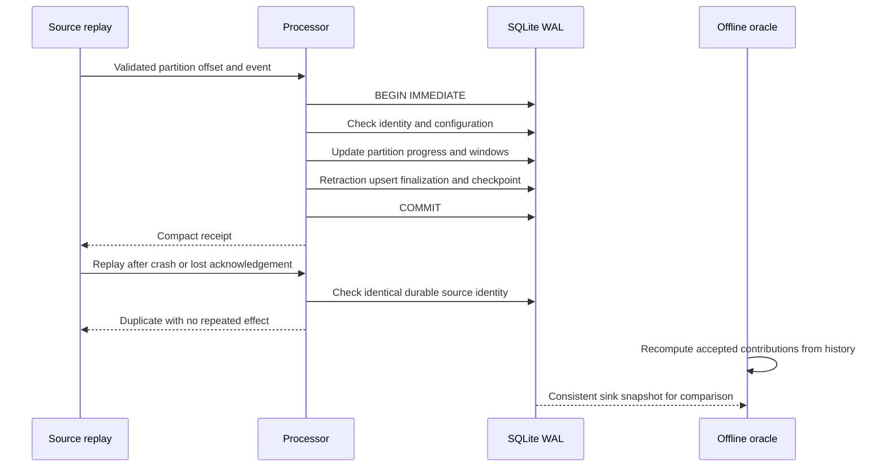

# From source identity to sink revision

`processor.py` owns validation, event-time policy, transaction state and sink updates. `io.py` bounds local JSON ingestion. `oracle.py` has independent history-based aggregation and a separate changelog consumer. `experiments.py` injects crashes, reopens real database files and checks replay against those references. The CLI supports fixed demonstrations/evaluation and actual persistent JSONL consumption.

See [watermark-contract.md](watermark-contract.md) for mathematics, transaction boundaries, capacities and failure semantics; [window-histories.md](window-histories.md) for executed evidence.
